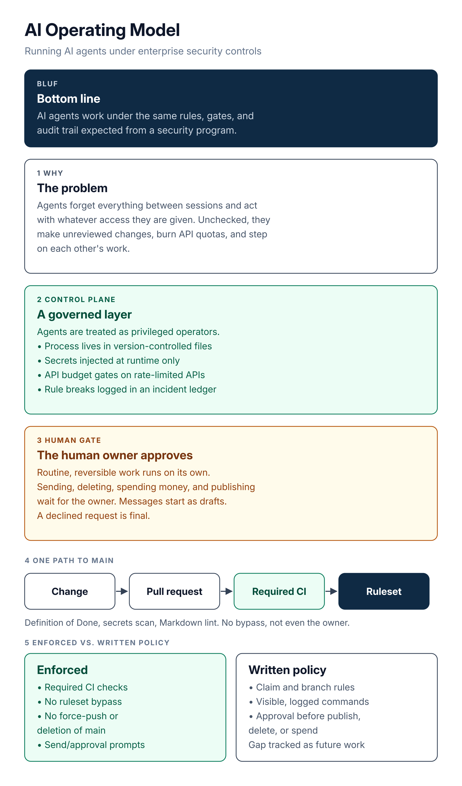

# AI Operating Model

A working pattern for running AI agents under enterprise security controls.

**Bottom line:** my AI agents work under the same kind of rules, gates, and audit trail I'd expect from a security program, and this repository shows how.

## What you'll find

- **Governance for multiple agents.** How agents claim work, stay in their own lanes, and log their own rule breaks in an incident ledger.
- **Approval gates and enforced controls.** What runs on its own, what waits for a human, and which controls a machine actually enforces.
- **Jarvis.** A personal AI on Rokid Glasses that I use as a real-world lab for guardrails and model testing.

![Control plane: AI agents run inside an agent sandbox (OpenShell) that confines files, processes, and system calls, with an API rate limit in the sandbox. Every network call leaves through the OpenShell supervisor, which checks policy and swaps in the real credential from the OpenShell provider store, fed at runtime by the secrets manager. Tool calls go to the MCP gateway, which checks tools, arguments, and caller, logs each call, and fronts one MCP servers group (for example GitHub, AI Operating Model, knowledge base). Model calls go to model providers (OpenRouter, Ollama). The Internet edge enforces limits outside the sandbox. The GitHub gate is the human gate: the owner approves PRs and merges. Opik traces model calls](diagrams/01-control-plane.png)

*The control plane: OpenShell is the outer boundary, every tool call goes through the MCP gateway, and anything consequential routes back to me for approval.*

Two separate layers, on purpose. [OpenShell](https://github.com/NVIDIA/OpenShell) is the outer boundary. The agents run inside its sandbox, and every network call leaves through its supervisor, which checks policy and swaps in the real credential. The MCP gateway sits outside the sandbox and checks every tool call: which tools, which arguments, and which caller, with every call logged. It fronts one group of MCP servers, such as GitHub, the AI Operating Model, and the knowledge base. API rate limiting runs in the sandbox, and the Internet edge enforces limits outside it. PRs and merges reach me through the pipeline at the GitHub gate, not through MCP. Both layers are tested, and now rolling out more widely. Opik traces model calls from OpenRouter, Ollama, and local resources.

### At a glance

*AI agents, run like privileged operators. Their process lives in version-controlled files, changes go through a gated pipeline, and anything consequential waits for me.*

## Featured: Jarvis

Jarvis is my personal AI assistant, built around Rokid Glasses. I also use it to test guardrails, try architecture ideas, and compare AI models, speech-to-text included, on accuracy and speed.

**[Explore Jarvis →](jarvis/README.md)**

 

## Why

AI agents are capable, but they forget everything between sessions and act with whatever access they are given. Without structure, they make unreviewed changes, burn through API quotas, and step on each other's work. This project treats agents as privileged operators. Their process lives in version-controlled files. Their changes go through a gated pipeline. Anything consequential waits for a human.

## What it covers

**Multi-agent governance and an incident ledger.** Each agent claims work before starting, works on its own branch prefix, and hands off with a link to a pull request, not a chat message. When an agent breaks a rule, the deviation is written up as an incident, and the incident feeds back into the rules.

**Human approval gates.** Routine, reversible work runs on its own. Sending messages, deleting anything, spending money, and publishing stop and wait for the owner. Outgoing messages are prepared as drafts. A declined request is final.

**Observability.** Agent commands should be visible and logged. Model calls routed through OpenRouter are traced in Opik. When something goes wrong, the logs and traces are the evidence, not the agent's own account.

## What is enforced vs. written policy

Not every control here is enforced by a machine yet. This table says which is which.

| Control | Status | How |
|---|---|---|
| Definition of Done, gitleaks secrets scan, and Markdown lint checks required before merge to main | Enforced | CI workflows run on every pull request, and the ruleset requires them |
| Prose style check (Vale) | Advisory | Runs on pull requests and leaves notes; it never blocks a merge |
| No bypass of the ruleset, including the owner | Enforced | Ruleset has an empty bypass list |
| Force-push and deletion of main blocked | Enforced | Ruleset rules |
| Tracing of model calls through OpenRouter | In place (monitoring, not a gate) | Opik tracing records calls; it does not block anything |
| Send and approval prompts for outgoing actions | Platform-enforced | Built into the agent platform |
| Agent claim and branch-ownership rules | Written policy | Shared rules card loaded on every run, plus incident ledger |
| Visible, logged commands for every agent | Written policy | Not yet enforced across all agents |
| Approval before publishing, deleting, spending money, or changing a calendar from email | Written policy | Followed by agents, reviewed through the ledger |

Closing the gap between written policy and enforcement is tracked as future work.

## How changes reach main

*Every change takes one path to main, and a failed check sends it back for a fix.*

This repository uses the gate it describes. GitHub Actions runs the Definition of Done check, the gitleaks secrets scan, and a Markdown lint on every pull request, and the GitHub ruleset on main requires all three. The ruleset also blocks force-push and deletion, with no bypass. A Vale prose check runs too, as advice only. See [docs/ruleset.json](docs/ruleset.json), or walk through it step by step in [How a change reaches main](docs/how-a-change-reaches-main.md).

## Repository layout

| Path | Contents |
|---|---|
| `docs/overview.md` | Full write-up: architecture, a case study on a shared control plane for rate-limited APIs, and lessons learned |
| `docs/how-a-change-reaches-main.md` | Step-by-step walkthrough of the change gate |
| `docs/ruleset.json` | Main branch ruleset applied to this repository |
| `jarvis/` | Jarvis, my personal AI on Rokid Glasses ([rundown](jarvis/README.md), [how it works, step by step](jarvis/how-jarvis-works.md), [image credits](jarvis/assets/CREDITS.md)) |
| `diagrams/` | Diagram sources (SVG) and PNG exports |
| `.github/` | Pull request template and CI workflows |

## License

MIT. See [LICENSE](LICENSE).
