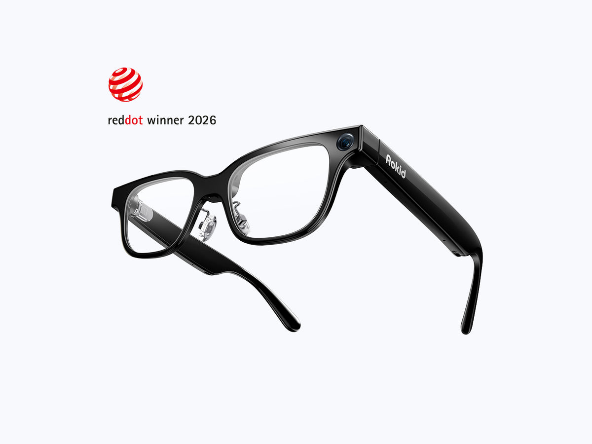
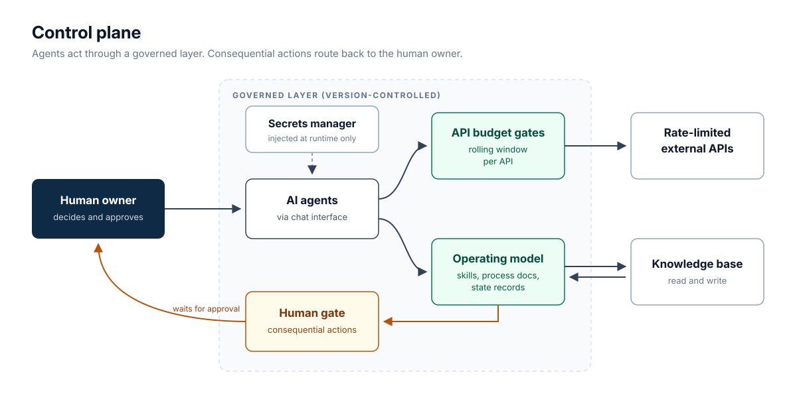

# AI Operating Model

A working pattern for running AI agents under the same controls you would expect from an enterprise security program.

## Featured project: Jarvis

Jarvis is my personal AI assistant: an AI that helps me wherever I'm wearing my Rokid Glasses. It's also a real-world system for testing guardrails, trying out architecture ideas, and comparing AI models on accuracy and speed, including speech-to-text.

**[Explore Jarvis →](jarvis/README.md)**

 

## Why

AI agents are capable, but they forget everything between sessions and act with whatever access they are given. Without structure, they make unreviewed changes, burn through API quotas, and step on each other's work. This project treats agents as privileged operators: their process lives in version-controlled files, their changes go through a gated pipeline, and anything consequential waits for a human.

## What it covers

**Multi-agent governance and an incident ledger.** Several agents share the same repositories and task board. Each one claims work before starting, works on its own branch prefix, and hands off with a link to a pull request rather than a chat message. When an agent breaks a rule, the deviation is written up as an incident, and the incident feeds back into the rules.

**Human approval gates.** Routine, reversible work runs on its own. Sending messages, deleting anything, spending money, and publishing stop and wait for the owner. Outgoing messages are prepared as drafts. A declined request is final.

**Observability.** Agent commands are meant to be visible and logged, and model calls routed through OpenRouter are traced in Opik. When something goes wrong, the logs and traces are the evidence, not the agent's own account.

## What is enforced vs. written policy

Not every control here is enforced by a machine yet. This table says which is which.

| Control | Status | How |
|---|---|---|
| Definition-of-Done, secrets scan, and Markdown lint checks required before merge to main | Pending | CI workflows are written but not yet added to this repository; the ruleset will require them once they land |
| No bypass of the ruleset, including the owner | Enforced | Ruleset has an empty bypass list |
| Force-push and deletion of main blocked | Enforced | Ruleset rules |
| Tracing of model calls through OpenRouter | In place (monitoring, not a gate) | Opik tracing records calls; it does not block anything |
| Send and approval prompts for outgoing actions | Platform-enforced | Built into the agent platform |
| Agent claim and branch-ownership rules | Written policy | Shared rules card loaded on every run, plus incident ledger |
| Visible, logged commands for every agent | Written policy | Not yet enforced across all agents |
| Approval before publishing, deleting, spending money, or changing a calendar from email | Written policy | Followed by agents, reviewed through the ledger |

Closing the gap between written policy and enforcement is tracked as future work.

## How changes reach main

This repository is meant to use the same gate it describes. The CI checks (a Definition-of-Done check, a secrets scan, and a Markdown lint) are pending: they are not running yet. Today the main branch ruleset blocks force-push and deletion with no bypass; once the workflows land, it will also require the three checks, as shown in [docs/ruleset.json](docs/ruleset.json).

## Read more

The full write-up, including architecture, a case study on a shared control plane for rate-limited APIs, and lessons learned, is in [docs/overview.md](docs/overview.md).

For a personal AI built around smart glasses, see the [Jarvis rundown](jarvis/README.md).

## Repository layout

| Path | Contents |
|---|---|
| `docs/overview.md` | Full narrative overview |
| `docs/ruleset.json` | Main branch ruleset applied to this repository |
| `jarvis/` | Jarvis, my personal AI on Rokid Glasses ([rundown](jarvis/README.md)) |
| `diagrams/` | Diagram sources (SVG) and PNG exports |
| `.github/` | Pull request template (CI workflows pending) |

## License

MIT. See [LICENSE](LICENSE).
