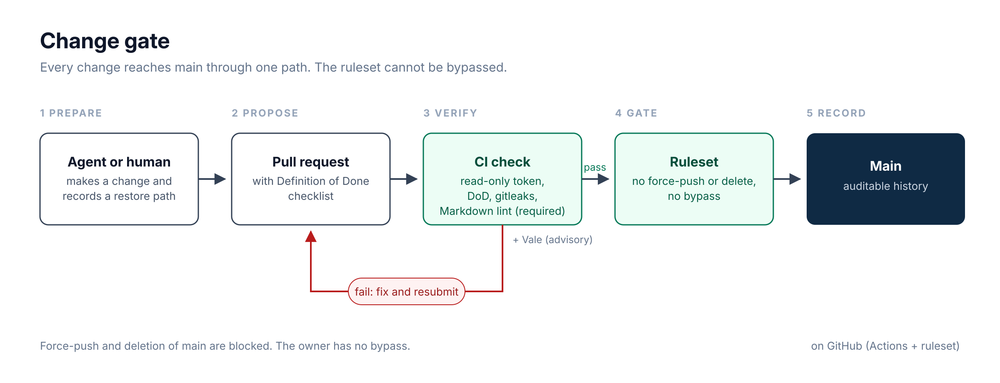

# AI Operating Model: governing AI agents with security controls as code

*The control plane: agents act through a governed layer, and anything consequential routes back to me.*

## Problem

AI assistants are powerful but forget everything between sessions. Left ungoverned, an agent can make unreviewed changes, exhaust API quotas, or mishandle credentials. I wanted my own agents to run under the same controls I'd expect from an enterprise security program.

## Approach

I built a personal "operating model": a version-controlled layer of process docs, reusable skills, and state records. Agents read it for context and must follow it when they act. Chat is only the interface. The record lives in reviewable files.

## Governing multiple AI agents

I run multiple autonomous AI agents that work in the same repositories and on the same agile board on GitHub. Without rules, they would collide: editing the same branch, picking up the same task, or quietly overwriting each other's work. I treat them the way I'd treat any team of privileged operators. The rules are written per agent, not per pair, so adding another agent means giving it an owner identity and a branch prefix, not rewriting the policy.

- **Claim before work.** An agent claims an issue before starting it, and each issue or branch has exactly one owner. If two claims conflict, the earlier one wins.
- **Separation of work.** Each agent works on its own branch prefix and never edits another agent's open branch or pull request. Pull requests are the only merge path.
- **Shared hard rules.** Every agent loads the same rules card on every run, so their policy can't drift apart.
- **Evidence, not chat.** A handoff is a link to a pull request or issue. A chat message doesn't count as proof that work was done.

**Incident ledger.** When an agent breaks a rule, the deviation is written up as an incident covering what happened, why, and what changed. Each incident feeds back into the rules. Real incidents have exposed gaps, and core rules have been amended because of them. An agent logs its own deviations, even against rules it drafted.

**Status.** These rules are written policy, plus a ledger I review. They are not yet technically enforced, so an agent could still break one. That gap is tracked as future work.

## Human approval gates

Agents work on their own when the work is routine and reversible. Anything with real consequences stops and waits for me.

- **What needs approval.** Sending a message or email, deleting anything, spending money, publishing something publicly, and changing a calendar based on something an agent read in email.
- **What doesn't.** Drafting, researching, opening a pull request, and other work that can be reviewed or undone.
- **Drafts, not sends.** Outgoing messages are prepared as drafts I review and send myself. A request to "handle it" is never permission to send.
- **Visible waits.** Work that needs my decision gets a human-in-the-loop label on the agile board, so a pending approval is visible instead of silently stalling.
- **Refusals are final.** If I decline or don't answer, the agent doesn't retry or find another route to the same action.

**Status.** Send and approval prompts for outgoing messages are enforced by the agent platform. Approval before deleting, spending money, publishing, and changing a calendar from email is written policy that the agents follow.

## Observability

I can't govern what I can't see, so agent activity is meant to be visible and traceable after the fact.

- **Visible commands.** Policy requires agents to show every command in a visible terminal before it runs and log it with a timestamp. Hidden background commands are not allowed.
- **Traced model calls.** Model calls routed through OpenRouter are traced in Opik, an open-source LLM tracing tool, so the data can be used to compare models, catch quality drift, and keep spending in check.
- **Review, not trust.** When something goes wrong, the logs and traces are the evidence behind the incident ledger, not an agent's own account of what it did.

**Status.** Opik tracing is in place for OpenRouter calls. Visible and logged commands are written policy that the agents follow, and they aren't yet enforced across every agent.

## Architecture

- **Work taxonomy.** Every piece of work has an identity (`domain | workstream | subject | purpose`), so context, ownership, and status are never ambiguous.
- **API budget gates.** A small control plane tracks rolling-window budgets for each rate-limited API. Agents check it before bulk calls instead of finding the limit by hitting it.
- **Backup before mutation.** A restore path is recorded before any code or config change.
- **Blocker taxonomy.** Every wait is classified (human, vendor, or external), so stalled work stays visible instead of silently rotting.

*One path to main, with no bypass.*

## Case study: a rate-limited API collector

One of my projects collects data from a vendor API with strict rate limits. Going over them means throttling or lost data, and several agents may want to call the same APIs.

- **One control plane, many adapters.** A shared gate tracks rolling-window budgets for each rate-limited API through a small interface: acquire before a call, record the result, report a snapshot, and back off. GitHub has a full gate of its own, and the collector plugs in through an adapter that wraps its existing limiter instead of rewriting it.
- **Check before bulk calls.** Agents read the shared snapshot before a large batch of calls instead of finding the limit by hitting it.
- **One pattern, not many.** A new API gets a new adapter in the same place, not a parallel mechanism.
- **Visible budgets.** A combined snapshot feeds a regular digest, so quota use is reviewed like any other operating metric.

**Lesson.** Rate limits are a shared resource. Treating them as a control plane, instead of leaving each script to handle its own, keeps every agent inside the same budget.

## Security by design

- **One secrets store.** Credentials are injected at runtime from a secrets manager. Nothing is committed, and CI does not keep a second copy.
- **Least-privilege CI.** Pipeline jobs get a read-only token. Cloud access is off by default, and short-lived federated credentials are the only allowed pattern.
- **Controls are enforced, not suggested.** Every change includes a Definition of Done checklist. GitHub Actions checks that the list is present and fully ticked. Items are self-attested. A GitHub ruleset blocks force-push and branch deletion and allows no bypass, not even for me. The ruleset requires the Definition of Done, gitleaks secrets scan, and Markdown lint checks before merge.
- **Sensitive operational state** (quota counters, local data) is excluded from version control by policy.

## Lessons

- A control that can be skipped will be skipped, by agents and by people. Make the check mandatory.
- Keep knowledge and executable process in separate systems of record, or both decay.
