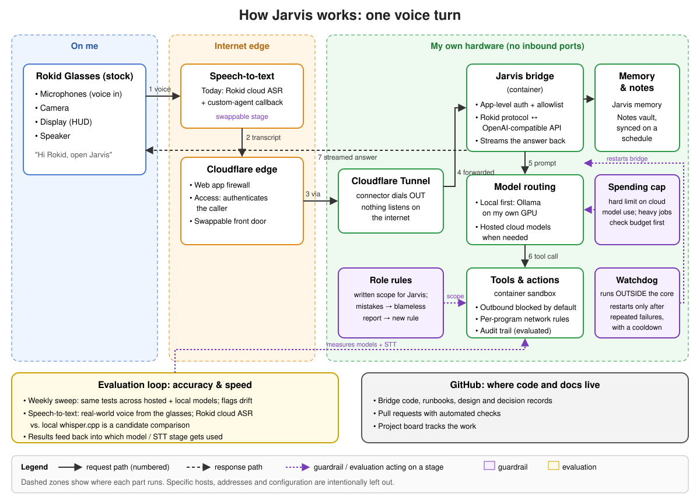

# Jarvis: a personal AI that goes where I go

Jarvis is my personal AI assistant. The goal is simple: an AI that helps me wherever I'm wearing my glasses.

I'm building it around [Rokid Glasses](https://store.rokid.com/products/rokid-glasses), lightweight AI glasses with a display, camera, and microphones. The plan is to connect Jarvis through Rokid's supported agent path, so the glasses stay stock. That connection is still a prototype.

## Why it matters to me

Jarvis is a real system I use every day, which makes it a good place to test guardrails on something that matters, not on a demo. The guardrails I'm trying out include:

- **Spending limits.** Cloud model use has a hard cap, so a runaway job can't run up a bill.
- **Sandboxing.** Before trusting an agent with real actions, I tested a sandbox to confirm it blocks what it should.
- **Recovery.** After an outage, Jarvis got a separate watchdog that brings it back if it goes down. A watcher has to live outside the thing it watches.
- **Staying in role.** When Jarvis once stepped outside its agreed role, it wrote a blameless report on itself, and the lesson became a rule.
- **A second set of eyes.** One experiment pairs Jarvis with a second agent so neither signs off on its own work.

## Experimenting with architecture

Jarvis is also a living lab. I use it to try out different ways of structuring a personal AI: which parts run locally and which in the cloud, how agents split up work, and how corrections turn into lasting rules. Some experiments stick and some get dropped. Either way, I learn from a system I actually depend on.

## Getting the glasses

Getting the glasses was its own project. When I tried to buy them, ordering directly for US delivery wasn't a reliable option, and eBay ended up being the best way to get a pair. Other US buyers [reported the same checkout problem](https://www.reddit.com/r/rokid_official/comments/1rwc06j/rokid_glasses_not_shipping_to_the_united_states/), and Rokid has since [said it is expanding US retail](https://www.globenewswire.com/news-release/2026/03/12/3255022/0/en/rokid-highlights-its-u-s-retail-strategy-at-vision-expo-2026.html).

[Image credits](assets/CREDITS.md)
