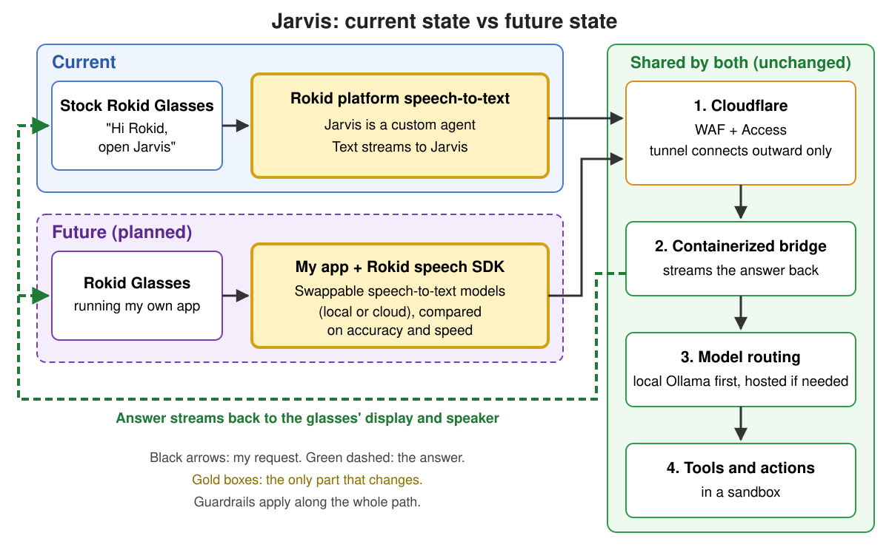

# Jarvis: a personal AI that goes where I go

Jarvis is my personal AI assistant. The goal is simple: an AI that helps me wherever I'm wearing my glasses. It's also a real-world system for testing guardrails, trying out architecture ideas, and comparing AI models on accuracy and speed, including speech-to-text.

The front end is a pair of stock [Rokid Glasses](https://store.rokid.com/products/rokid-glasses): lightweight AI glasses with a display, camera, microphones and a speaker. Jarvis registers as a custom agent on Rokid's supported agent platform, so I say "Hi Rokid, open Jarvis" and nothing on the glasses has to be modified or sideloaded. The glasses link is still a prototype.

## How it works

1. **Voice in.** I speak to the glasses. Rokid's platform turns my speech into text and sends that text to Jarvis.
2. **Cloudflare as the front door.** The callback doesn't reach my hardware directly. It lands on Cloudflare's edge, where a web application firewall and Cloudflare Access check it first. A Cloudflare Tunnel then carries it home. A small Cloudflare program, `cloudflared`, runs next to the bridge and dials *out* to Cloudflare's network, keeping an encrypted connection open. That's the same kind of outbound connection a browser makes, so my home firewall never has to accept anything incoming. When a request passes the edge checks, Cloudflare sends it down that already-open connection, and the answer goes back up the same way. Nothing at home listens on the internet, there's no open port to scan, and my home IP address stays hidden behind Cloudflare. If the tunnel goes down, there's simply no path in. The app checks its own credentials and an allowlist too, so passing the edge isn't enough on its own. The front door is designed to be swappable, so Cloudflare could be replaced later without touching the glasses or the bridge.
3. **A containerized bridge.** A small bridge service in a container translates between Rokid's agent protocol and an OpenAI-compatible model interface. It streams the answer back to the glasses as it's generated, so the display and speaker start responding before the full answer is done.
4. **Model routing: local first.** The bridge talks to a local model first (Ollama on my own GPU) and can use hosted cloud models when a task needs them. Because the interface is standard, swapping models is a configuration change, not a rewrite.
5. **Answer out.** The response streams to the glasses' display and speaker, formatted for a small heads-up display: one main message and only a few steps.
6. **Memory and notes.** Jarvis keeps its own memory, and my notes vault stays in sync on a schedule, so what I capture on the go ends up with the rest of my notes.
7. **GitHub as home base.** The bridge code, design docs, runbooks and decision records live on GitHub. Changes go through pull requests with automated checks, and work is tracked on a project board.

## Current state vs future state

**Current state.** Stock Rokid Glasses, with Jarvis registered as a custom agent on Rokid's platform. I say "Hi Rokid, open Jarvis", Rokid's platform turns my speech into text, and that text streams to Jarvis. From there it goes through Cloudflare to the containerized bridge, model routing, and sandboxed tools and actions, and the answer streams back to the display and speaker.

**Future state (planned).** I build my own app on the glasses using Rokid's speech SDK. That puts the audio and speech-to-text stage in my hands, so I can swap and compare speech-to-text models, local or cloud, on accuracy and speed, alongside the model comparisons I already run. Everything downstream (Cloudflare, the bridge, model routing, the sandbox, and the guardrails) stays the same.

## Guardrails, and where they act

Because Jarvis is a real-world example, it lets me test different guardrails, configurations, and prompts, then look for weaknesses I can use to make further improvements.

- **At the edge:** Cloudflare filters and authenticates traffic before it reaches home, and the app checks credentials again on its own.
- **Around actions:** I evaluated a container-based sandbox for running tools and actions. I test how well it enforces the rules, such as blocking outbound traffic by default, per-program network rules, filesystem lockdown and a full audit trail, and I keep expanding that testing as needed. Sandboxes started in about 1–2 seconds, which matters when a voice reply needs to land in a few seconds.
- **Around spending:** Cloud model use has a hard spending cap, and heavy jobs check the remaining budget before they run.
- **Around uptime:** After an outage, Jarvis got a watchdog that runs outside the system it watches. It only acts after repeated failed checks, and it waits between restarts so it can't loop.
- **Around its role:** When Jarvis once went beyond its agreed role, it wrote a blameless report on itself and the lesson became a written rule. Corrections become rules, not reminders.

### Planned guardrails

As Jarvis grows from answering questions to taking real actions, the guardrails grow with it:

- **Action catalog.** A defined list of what Jarvis is allowed to do, so nothing outside it can run.
- **Risk levels.** Each action is classified by risk, and riskier actions get stricter handling.
- **Approval routing.** Higher-risk actions wait for my approval before they run.
- **Rollback.** Actions are designed so they can be undone when something goes wrong.
- **Sandboxed tool runner.** Tools that take real actions run in their own contained sandbox, separate from the voice bridge.
- **Swappable sandbox.** A thin adapter keeps the sandbox replaceable, and its policies stay as portable files.
- **No self-approval.** Jarvis never approves changes to its own rules. It can propose a change, and I decide.

## Experimenting with architecture

Jarvis is also a living lab for designing a personal AI:

- **Local vs cloud.** What runs on my own GPU, and what's worth sending to a hosted model.
- **Swappable parts.** The front door and the model sit behind standard interfaces, so I can trade one out and compare. With the planned app, speech-to-text becomes swappable too.
- **A control plane.** My agile board is the control plane for Jarvis. Work and changes are planned and tracked there, so I can see what's in progress and what's waiting on me. I built it on GitHub because that was the expedient choice for now, but GitHub's API rate limits keep it from scaling, so I'll probably move to a dedicated GitLab or another tool.
- **Latency budget.** A voice turn has to feel instant, so every piece (edge, tunnel, sandbox, model) is judged by what it adds to the response time.

Some experiments stick and some get dropped. Either way, I learn something from each one.

## Testing AI models

Jarvis also gives me a real-world way to compare AI models on **accuracy and speed**:

- **Language models.** A scheduled weekly sweep runs the same tests across a set of hosted models and my local models. It flags any model whose results drift from the previous run and picks up newly released models.
- **Speech-to-text.** Wearing the glasses means real-world voice testing. Today that shows how accurately and how quickly Rokid's recognition understands me. The planned app will let me compare speech-to-text models against each other.

## Getting the glasses

Getting the glasses was its own project. When I went to order them, Rokid wouldn't ship to the US, so I had to buy a pair on eBay. Other US buyers [reported the same checkout problem](https://www.reddit.com/r/rokid_official/comments/1rwc06j/rokid_glasses_not_shipping_to_the_united_states/), and Rokid has since [said it is expanding US retail](https://www.globenewswire.com/news-release/2026/03/12/3255022/0/en/rokid-highlights-its-u-s-retail-strategy-at-vision-expo-2026.html).

[Image credits](assets/CREDITS.md)
