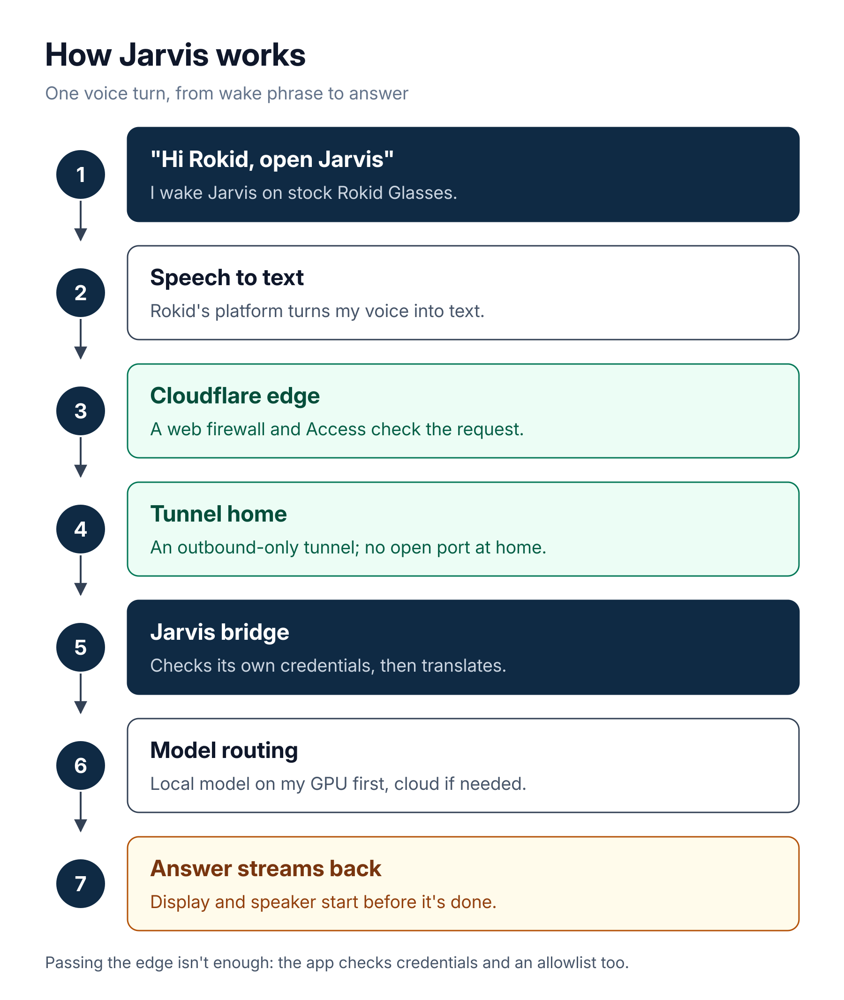

# How Jarvis works

[← Back to Jarvis](README.md) · [AI Operating Model](../README.md)

**Bottom line:** I say "Hi Rokid, open Jarvis" and my question goes from stock Rokid Glasses, through Cloudflare's checks and an outbound-only tunnel, to a bridge and models I run at home. The answer streams back to the glasses. Nothing at home listens on the internet.

*One voice turn, from wake phrase to answer.*

## The steps

1. **Wake it.** I say "Hi Rokid, open Jarvis". The glasses are stock: nothing on them is modified or sideloaded.
   *Jarvis is registered on Rokid's platform, so the wake phrase is all it takes.*
2. **Speech becomes text.** Rokid's platform turns my speech into text and sends that text to Jarvis.
   *Today Rokid handles speech-to-text; my own app with Rokid's speech SDK is planned.*
3. **Cloudflare checks it first.** The request lands on Cloudflare's edge, where a web application firewall and Cloudflare Access check it.
   *Nothing reaches my hardware directly.*
4. **A tunnel carries it home.** `cloudflared` runs next to the bridge and dials *out* to Cloudflare, keeping an encrypted connection open. Requests that pass the edge come down that connection.
   *No open port, no inbound connections, home IP hidden. If the tunnel is down, there is no path in.*
5. **The bridge checks again and translates.** A containerized bridge checks its own credentials and an allowlist, then translates Rokid's protocol into an OpenAI-compatible model interface.
   *Passing the edge isn't enough on its own.*
6. **Models answer, local first.** The bridge tries a local model (Ollama on my own GPU) first and uses hosted cloud models when a task needs them.
   *Swapping models is a configuration change, not a rewrite.*
7. **The answer streams back.** The response streams to the glasses' display and speaker as it's generated, formatted for a small heads-up display.
   *The glasses start responding before the full answer is done.*

## Around every turn

- Every network call leaves the sandbox through the [OpenShell](https://github.com/NVIDIA/OpenShell) supervisor. Tool calls then go through an MCP gateway that checks the tool, its arguments, and the caller, and logs the call. Both are tested, and now rolling out more widely.
- Jarvis runs inside the [OpenShell](https://github.com/NVIDIA/OpenShell) sandbox, with outbound traffic blocked by default. It holds only a placeholder credential, and the supervisor swaps in the real one for approved destinations.
- Opik traces model calls from OpenRouter, Ollama, and local resources.
- Cloud model use has a hard spending cap.
- A watchdog outside the system restarts the bridge only after repeated failed checks.
