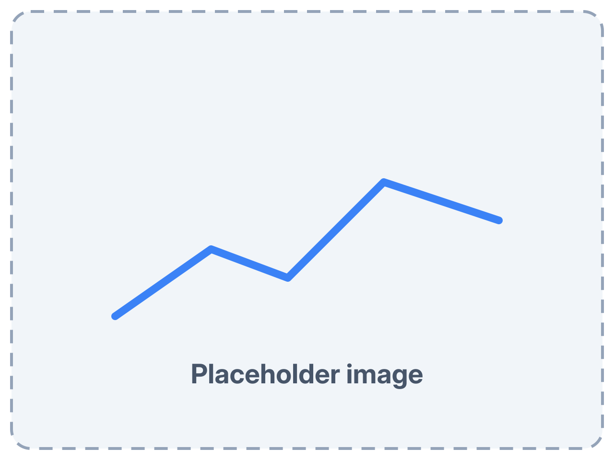
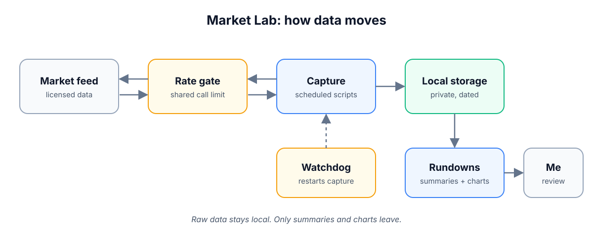
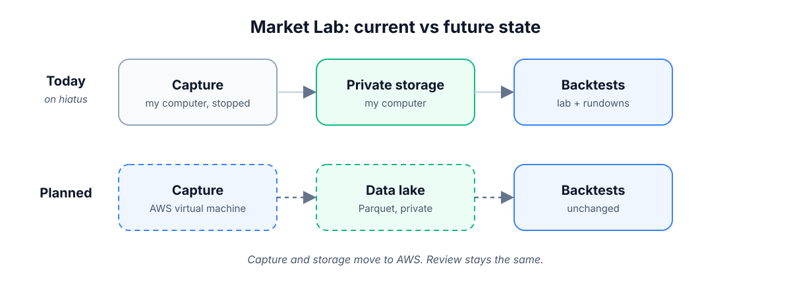

# Market Lab: a personal market-data pipeline

[← Back to the AI Operating Model](../README.md)

Market Lab is my personal market-data pipeline.
It captures live market data on a schedule, stores it privately, and turns it into summaries and charts I can read.
It's analysis only. It never places anything in the market.
It's also where I practice running scheduled jobs, guardrails, and AI agents against real, messy data.

*Placeholder image. A real one comes later.*

## How it works

For a step-by-step walkthrough, see [How Market Lab works](how-market-lab-works.md).

*One capture session, simplified.*

1. **Scheduled start.** Capture jobs start before the market opens and wait for the session.
2. **Sign-in check.** When the data provider asks, I confirm sign-in on my phone.
3. **Rate gate.** Every call goes through one shared limit, so jobs can't flood the feed.
4. **Capture.** Scripts record market depth and quotes during set windows.
5. **Private storage.** Raw data lands in dated local folders and is never committed or shared.
6. **Rundowns.** After the close, an agent turns the data into summaries and charts.
7. **Review.** I read the rundown. Summaries go to my notes through a pull request.

## Current state vs future state

*Only the storage layer changes between today and the plan.*

**Current state.** Capture runs on my own computer. Raw data stays in local, dated folders. Summaries and charts go to my notes.

**Future state (planned).** Storage moves to the cloud on AWS: a data lake for raw files and a database for cleaned data. The design is still open. Capture and review stay the same.

## Guardrails, and where they act

- **Around scope:** The project reads market data only. It has no way to act in the market.
- **Around the feed:** One shared rate gate covers every script, with a limit set below the provider's ceiling.
- **Around sign-in:** Credentials live in a secrets manager, not in the repo. The provider's sign-in check comes to my phone.
- **Around the data:** Raw feed data is licensed for private use. It stays local and out of Git. Only summaries and charts leave.
- **Around uptime:** A watchdog checks capture during the session and restarts it if it stops. It pings me only when it needs me or after a fix.
- **Around honesty:** Every result is labeled with where its data came from, and known gaps are tracked in a register.
- **Around changes:** Code changes go through pull requests with security scans, like every repo here.

## Experimenting with architecture

Market Lab is a place to try ideas on a small, real system:

- **Storage tiers.** Comparing local folders with a hosted lake and database before committing to one.
- **Safe migration.** Planning a move of capture to new hardware without losing a session.
- **Pluggable analysis.** A lab engine where each piece of a test run can be swapped.

## Testing AI models

AI agents do much of the work around the data. They write the rundowns, draft the charts, and propose code changes.
I review what they produce. Every change still comes to me through a pull request.
